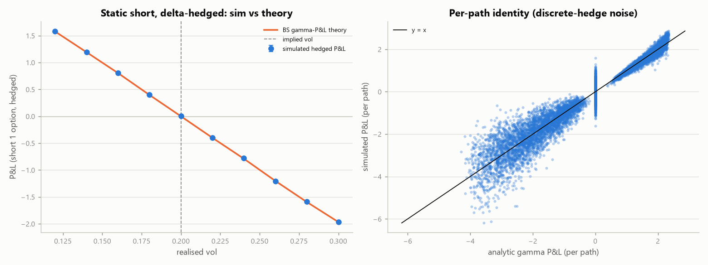
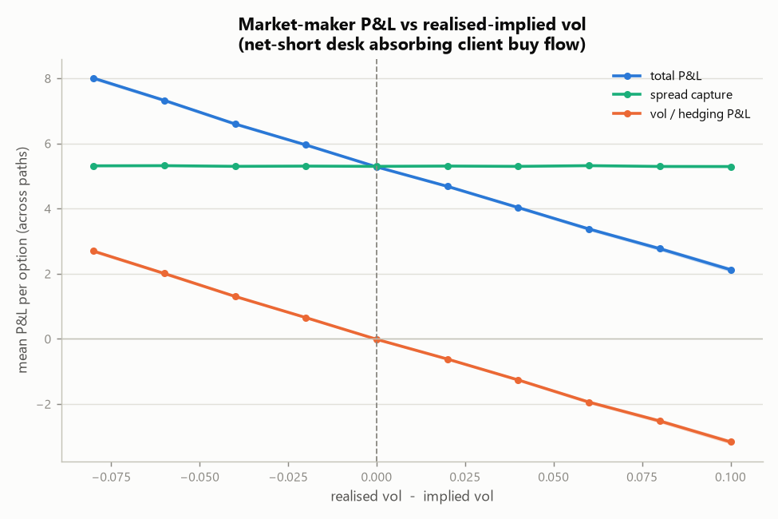
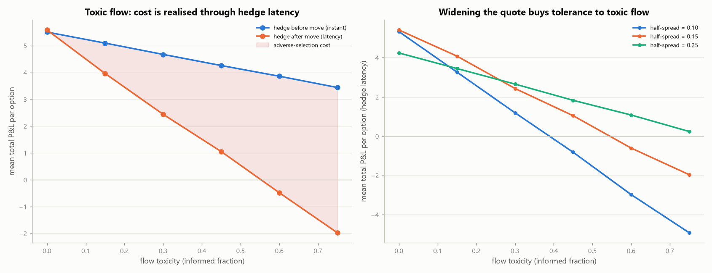
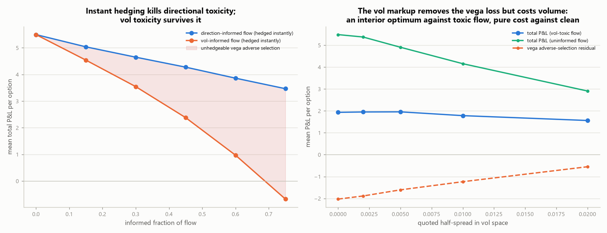
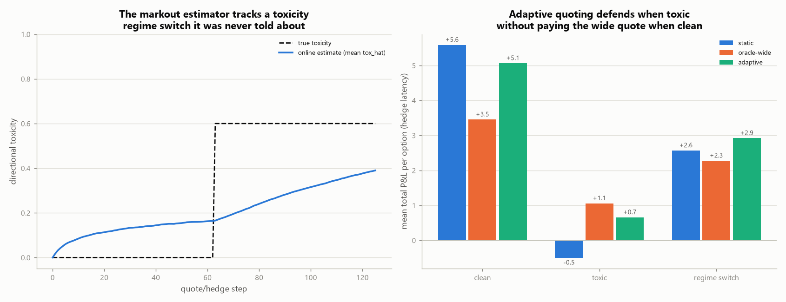
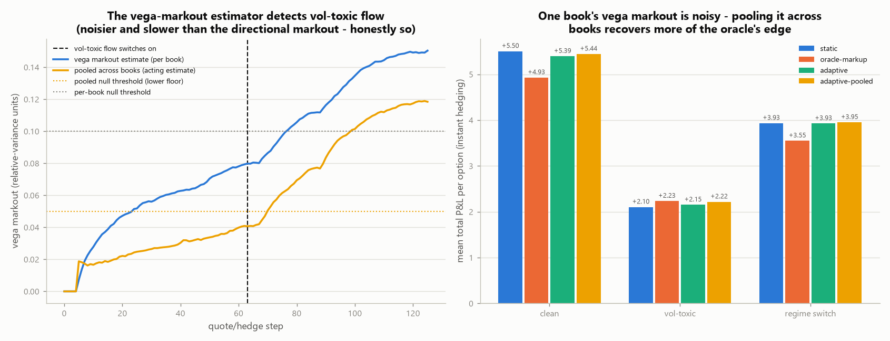
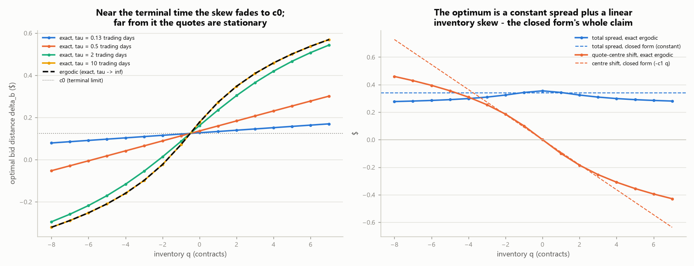
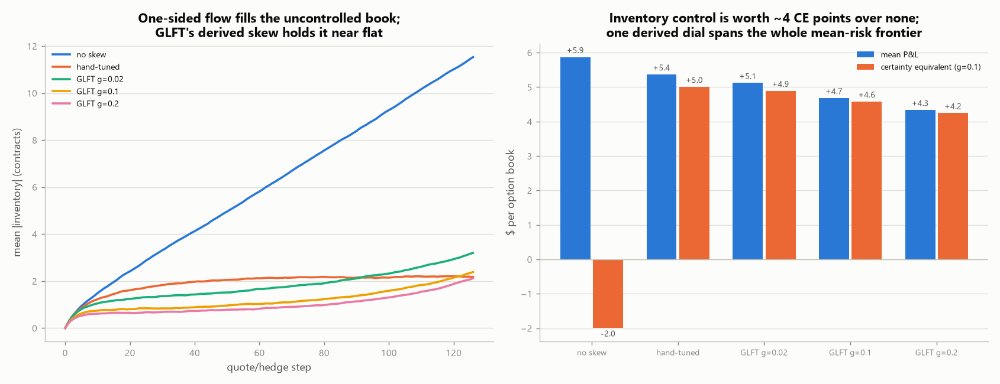
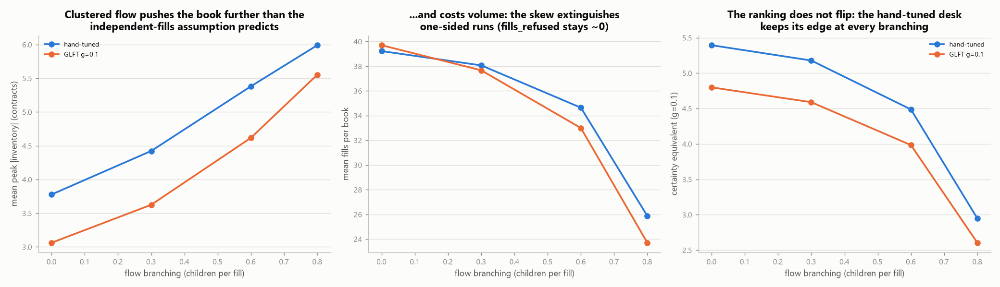

# Options market-making simulator

A delta-hedged options market-maker on a single European option, built to show
the two P&L engines a real options desk runs on and how they trade off against
each other. Run it:

```bash
python market_making/mm_sim.py          # prints the tables, writes charts/market_making/
python -m pytest tests/test_mm.py -q    # verifies the engine (see below)
```

## The idea

An options market-maker earns money two ways, and they pull in different
directions:

1. **Spread capture.** It quotes a two-sided market around the theoretical
   value and earns the edge (half-spread, adjusted for inventory skew) every
   time incoming flow crosses its quote. This depends on *volume*, not on where
   volatility lands.
2. **Vol / hedging P&L.** Whatever net options position the flow leaves it
   holding, it delta-hedges. Delta-hedging strips out the direction of the
   underlying but leaves a **gamma** exposure whose P&L is set by the gap
   between the volatility it *quoted* (implied) and the volatility the
   underlying actually *realises*. A net-short desk makes money when the market
   is calmer than it priced and loses when it is wilder.

The desk's job is to set a spread wide enough that engine (1) pays for the risk
it takes on in engine (2).

## The model

* **Underlying:** GBM with a *realised* vol `sigma_real` (the "true" world).
* **Fair value:** Black-Scholes at the desk's *implied* vol `sigma_impl` — the
  vol it quotes, marks, and hedges at.
* **Quoting:** an [Avellaneda-Stoikov](https://www.math.nyu.edu/~avellane/HighFrequencyTrading.pdf)-style
  arrival intensity `lambda = A * exp(-k * d)`, where `d` is the quote's
  distance from fair. Inventory is controlled by skewing the reservation price
  `theo - skew * inventory`, which tightens the side that reduces inventory and
  widens the side that grows it. Two policies set the width and skew:
  `quote_policy="static"` uses the hand-picked `half_spread` / `skew_coef`,
  and `quote_policy="glft"` *derives* both from the
  Gueant-Lehalle-Fernandez-Tapia closed-form optimum for this same intensity
  model (see `glft.py` and Experiment G).
* **Client flow:** a `flow_imbalance` parameter makes clients net buyers (they
  lift the desk's offers), so the desk accumulates a **net short** book — the
  realistic case where an MM absorbs one-sided demand.
* **Hedging:** delta-hedged every step at the *implied-vol* delta (standard
  "hedge at the vol you marked at"). All cash flows — option fills, hedge
  trades, expiry settlement — run through a single cash account, so terminal
  cash *is* the P&L.
* **Financing:** cash accrues at `r`, the hedge book earns the continuous
  dividend yield `q`, and the gamma-P&L identity below carries its `e^{r(T-t)}`
  financing factor, so `r` and `q` are supported (and tested) — the experiments
  just default to `r = 0` to keep the vol P&L uncluttered.

## Is it correct? (Experiment A)

Hedging at implied vol, a short option held to expiry has a known closed-form
P&L — the gamma-P&L identity:

```
PnL  ≈  0.5 * integral[ e^{r(T-t)} * Gamma_impl(t) * S(t)^2 * (sigma_impl^2 - sigma_real^2) ] dt
```

Experiment A runs a static short option through the hedger and compares the
simulated P&L to that integral. They match to Monte-Carlo error across the whole
vol range, and the P&L crosses zero exactly at `sigma_real = sigma_impl`:



Left: simulated mean P&L (points) sits on the theoretical curve (line). Right:
per path, simulated P&L tracks the analytic gamma-P&L along `y = x`, with the
scatter being the discrete-hedging error that vanishes as the hedge frequency
rises. This is what makes the vol P&L in the full simulator trustworthy rather
than merely plausible. `tests/test_mm.py::test_hedging_identity` enforces it.

## The result (Experiment B)

The full market-maker — two-sided quoting, inventory skew, client buy-flow
imbalance, delta-hedged — swept across realised vol:



* **Spread capture (green)** is flat — by construction: fill intensity depends
  only on quote distance and inventory, not on where vol lands, so the desk
  earns its edge on volume in every scenario.
* **Vol / hedging P&L (red)** slopes down through zero at implied vol: the
  net-short book profits when the world is calm and bleeds gamma when it is
  wild.
* **Total (blue)** is their sum. At the implied vol the desk quoted, it keeps
  roughly the full spread; as realised vol runs above implied, the gamma losses
  eat into and eventually overwhelm the spread.

The lesson, and the reason a market-maker's spread is not arbitrary: **the
spread has to be wide enough to pay for the vol risk of the inventory the flow
forces onto the book.** A representative inventory path (net short, mean-reverted
by the skew) is in `../charts/market_making/sample_inventory_path.png`.

## Adverse selection / toxic flow (Experiment C)

Real flow is not uninformed. A `toxicity` parameter makes a fraction of orders
**informed** - they lift the desk's offer just before the underlying rises and
hit its bid just before it falls. Sweeping toxicity at realised = implied vol:



The result is subtle and correct. **Delta-hedging neutralises the *direction* of
informed flow**, so if the desk could hedge instantaneously (green, hedge before
the move) toxic flow costs it little beyond fewer round-trips. The
adverse-selection loss proper appears only with a **hedge latency** (red, hedge
after the move): the inventory an informed trade leaves behind rides the move
unhedged, and that cost grows straight through zero as toxicity rises. The gap
between the two lines is the adverse-selection cost, and it is exactly the
lag-1 residual in the table `mm_sim.py` prints (~0 with no toxicity, strongly
negative with it).

The desk's defence is the second panel: **a wider quoted spread buys tolerance to
toxic flow.** Too tight and toxic flow turns the book negative; too wide and the
desk leaves money on the table in benign flow - the lines cross, so the optimal
spread depends on how toxic the flow is. That is why market-makers widen in fast,
informed markets. `tests/test_mm.py` asserts both facts: the cost needs a hedge
lag, and a wider spread survives more toxicity.

## Vol-informed flow: the toxicity hedging can't fix (Experiment D)

Directional toxicity is a *speed* problem — Experiment C shows instant hedging
nearly eliminates it. Experiment D adds the kind it cannot fix: a
`vol_toxicity` fraction of flow informed about the **vol regime** rather than
the next move. Each Monte-Carlo path realises `sigma_impl ± vol_shock` with
equal probability (fair on average, so any loss is pure adverse selection);
vol-informed clients buy options on the paths that will realise high vol and
sell options to the desk on the quiet ones.



Left panel — both desks hedge **instantly**. The direction-informed desk's vol
residual stays ~0 at every toxicity (its total declines only because informed
flow is one-sided volume). The vol-informed desk bleeds: it is systematically
short gamma into storms and long gamma into calm, and no hedge frequency
touches that — the informed side has selected which vol regime each side of
the book rides. Speed fixes directional toxicity; nothing operational fixes
vega toxicity.

Right panel — the defence is **price, in the right currency**: a `vol_spread`
quotes asks at `sigma_impl + vol_spread` and bids at `sigma_impl - vol_spread`,
charging every option trade a vega edge (which collapses naturally as vega dies
into expiry). The markup drives the vega adverse-selection residual toward zero
— but it also widens the quote and kills volume, so against toxic flow the
optimum is *interior* (a modest markup beats none), and against clean flow any
markup is pure cost. There is no free defence; the markup is worth exactly as
much as the flow is toxic. `tests/test_mm.py` asserts all three facts.

## Online toxicity estimation (Experiment E)

Experiments C and D treat the informed fraction as known. A real desk has to
**infer it from its own fills**. The estimator is a one-bar markout: a fill
"agrees" when the underlying moves the client's way on the next bar. Informed
flow trades one side only, so the informed share of *fills* is
`f = tox/(2-tox)`; the agreement rate is `0.5 + f/2`, and inverting gives
`tox_hat`. The running estimate is a bias-corrected EWMA (the remaining weight
of the 0.5 prior is divided out, Adam-style, then the estimate is shrunk by
its evidence weight so early noise cannot rectify into phantom toxicity).
With `adaptive_spread` on, the desk widens its quote by `spread_slope *
tox_hat` — using only information available at quote time.



Three desks (static, oracle-wide — permanently sized for the toxic regime —
and adaptive) run through clean, toxic, and regime-switching flow, all with
hedge latency. The adaptive desk defends like the oracle in toxic flow without
paying the oracle's volume cost in clean flow, and on the **regime switch it
beats both fixed policies** — adapting is worth most exactly when toxicity is
time-varying. The estimator is honestly imperfect: it carries a detection lag
after the switch (left panel — it is still converging at expiry) and a small
phantom-toxicity floor from markout noise, which is why the adaptive desk
gives up a little to the static one in permanently clean flow.
`tests/test_mm.py` asserts the estimator's convergence, its regime tracking,
and all three desk-comparison facts.

## Online vol-toxicity estimation (Experiment F)

Experiment E's markout estimator is blind to vol-informed flow (its fills
agree with the next move only half the time), so Experiment F adds the
vega-space analogue: each net client fill is scored against the **realised
variance of the next few bars** relative to implied — did the market get
wilder right after clients bought options? A single squared return is
chi-square noisy, so the markout uses a K-bar window (ring-buffered: the
observation lands K bars after the fill, late but causal), and the desk marks
up its quoted vol only on the estimate's **excess over a calibrated null
threshold** — the clipped EWMA has a positive noise floor even on clean flow,
and without that deadband the desk taxes clean flow for phantom toxicity.

Two structural points the experiment surfaces:

* **Identifiability needs regime variation.** With one fixed vol regime per
  path, a clean desk that happens to sit in the high-vol regime is
  statistically indistinguishable from a vega-picked-off one. Vol regimes
  here redraw every ~2 months within each book, and that is what makes the
  flow-vs-variance correlation learnable at all.
* **Detection is cheap; per-book repricing is not.** The estimator separates
  vol-toxic from clean and from direction-toxic flow cleanly (and `tox_hat`
  separates the directional kind right back — the two estimators partition
  the two toxicity types). But one book's vega markout is noisy enough that
  the adaptive markup recovers only part of the fixed oracle markup's edge in
  stationary toxic flow — while skipping the oracle's clean-flow tax and
  beating it when toxicity switches regime. This is the honest asymmetry
  against the directional case, where ~30 clean binary markouts per book were
  enough to nearly match the oracle: acting on vega toxicity at scale needs
  **pooling across books** — which is exactly what the fourth desk below does.



### Pooling markouts across books

The vega markout is already vega-normalised — relative-variance units,
`side * (realised var / implied var − 1)` — so its magnitudes are comparable
across books and strikes, and it pools. With `pool_books = B > 1`, each group
of B consecutive Monte-Carlo paths becomes the B books of **one desk**: every
book keeps its own markout EWMA, and quotes off an empirical-Bayes blend of
its own estimate and the evidence-weighted pool mean,

```
shrunk_i = w_i * own_i + (1 - w_i) * pooled,     w_i = n_i / (n_i + pool_shrinkage)
```

(`pool_vega_markouts` in `mm_sim.py`). A thin book borrows the pool's
strength; a book whose own markouts keep disagreeing with the pool takes its
weight back as its markout count `n_i` grows past `pool_shrinkage` (~one EWMA
effective window by default) — so a genuinely different book *separates* from
the pool instead of being averaged away. The read is causal (a cross-section
of states built only from resolved fills), and `pool_books = 1` — the default —
reproduces the per-book behaviour bit-for-bit.

Where the edge actually comes from, and how big it honestly is: pooling ten
books cuts the estimate's dispersion and lets the desk **recalibrate its
null threshold down** (~0.05 vs the per-book 0.10 — the deadband exists
purely to reject the clipped estimator's noise floor, and the pooled floor
is lower: ~0.047 vs ~0.071 measured on clean flow). Same markup rule, same
slope, same cap. The P&L translation, measured at 25,000 paths per run, is
real but small (~0.03–0.06 per scenario, seed-consistent at that size but
*below the single-seed noise floor* of the 4,000-path tables above — do not
expect to see it in them):

* **Stationary vol-toxic flow** — the pooled desk recovers roughly **twice
  the per-book desk's share** of the oracle markup's edge (~half of it vs
  ~a fifth), though the oracle keeps the rest: a finite-window vega markout
  cannot fully price the toxicity it detects.
* **Clean flow** — the pooled desk's phantom-toxicity tax is about **half
  the per-book desk's**: the tighter estimate rectifies less noise above
  the threshold.
* **Regime switch** — the adaptive desks beat the oracle's fixed markup
  (which pays its clean-flow tax for nothing); they do not beat static
  here, the honest small print: on this switch the markup's value is
  avoiding the oracle's mistake, not beating no defence.

What pooling assumes, honestly: **cross-book exchangeability** of
vega-normalised toxicity — the pooled books differ only in noise, not in
clientele. Here that holds for the toxicity *schedule* by construction
(every path faces the same `vol_toxicity`), though each book rides its own
vol regime, so the arena is exchangeable-ish rather than exactly — one
reason the recovered edge stays partial. A real desk's book with
structurally different flow violates the assumption outright, and until
that book accumulates ~`pool_shrinkage` of its own markouts the pool
actively drags its estimate toward the crowd: pooling trades per-book
variance for cross-book contamination bias, and `pool_shrinkage` is the
exchange rate. The borrow-then-release mechanics are tested directly at the
estimator level (the simulator cannot yet give one book its own toxicity
in-path).

`tests/test_mm.py` asserts the discrimination (both directions), the
gamma-P&L identity under full vol paths, the three desk-comparison facts,
and for pooling: the faster convergence on exchangeable flow, the
borrow-then-release shrinkage, causality of the pooled estimate, the P&L
edge measured at 25k paths (`test_pooling_edge_measured_at_power`), and
that the default (`pool_books = 1`) path is byte-identical to the per-book
estimator.

## Deriving the quotes instead of picking them (Experiment G)

Everything up to here quotes with two hand-picked numbers: `half_spread` and
`skew_coef`. `glft.py` replaces the hand-picking with the **optimal** spread
and skew for exactly the fill model the simulator already uses, via
Gueant-Lehalle-Fernandez-Tapia (["Dealing with the inventory risk"](https://arxiv.org/abs/1105.3115),
Math. Fin. Econ. 2013) — the tractable successor to Avellaneda-Stoikov that
real quoting engines implement. GLFT's contribution is that the HJB equation
*linearises*: the value function on the inventory grid solves a linear ODE
system `v(t) = expm(-M (T-t)) v(T)` for a symmetric tridiagonal `M`, the
optimal quotes are neighbour-ratios of `v`, and far from expiry they collapse
to a closed form practitioners actually use:

```
delta_b(q) ~ c0 + (2q+1)/2 * c1        c0 = (1/gamma) ln(1 + gamma/k)
delta_a(q) ~ c0 - (2q-1)/2 * c1        c1 = sqrt( sigma^2 gamma / (2kA) * (1+gamma/k)^(1+k/gamma) )
```

— a **constant total spread** `2 c0 + c1` plus a **linear inventory skew**
`-c1 * q` of the quote centre. The module implements all three routes (exact
finite-horizon via eigendecomposition, exact stationary via the ground
eigenvector, closed form) and `tests/test_glft.py` cross-checks them against
each other and against the paper's literal matrix exponential;
`../charts/market_making/glft_quotes.png` shows the finite-horizon quotes converging to the
stationary ones and the closed form's accuracy.



Experiment G runs the derived quotes against the hand-tuned ones under
one-sided client flow with **uncertain realised vol** (`sigma_impl ±
vol_shock`, fair on average — the arena where a hedged desk's inventory is a
live vega bet). The option maps onto GLFT's single-asset model through its
instantaneous dollar vol `|delta| * sigma * S`, and desks are judged on the
CARA certainty equivalent — the criterion GLFT actually optimises, applied
evenly to every desk:



Three honest findings, all asserted in `tests/test_glft.py`:

* **Inventory control is worth ~4 CE points over none.** The no-skew desk
  keeps the fills but wears a ±8-sigma book; every controlled desk holds the
  book near flat and converts most of the mean into certainty equivalent.
* **One dial spans the frontier.** Sweeping `gamma` traces mean-vs-dispersion
  monotonically — risk aversion buys inventory control and pays in width —
  with every parameter meaning something (`A`, `k` measured from the fill
  model, `sigma` from the option, `gamma` chosen).
* **The mapping's conservatism is visible and explainable.** The hand-tuned
  desk stays competitive on CE because `|delta| * sigma * S` prices *unhedged*
  option inventory while the desk delta-hedges, so GLFT over-skews — its
  quotes sit on the conservative (low-dispersion) side of the frontier. The
  fix would be a hedged-inventory risk measure, which is exactly where the
  model stops being closed-form; `gamma` is the honest knob in the meantime.

Model caveats, stated rather than hidden: CARA utility and exponential fill
intensities are what make GLFT tractable, both are modelling choices; the
closed form is exact only far from expiry, far from the inventory bound, in
the continuum-inventory limit (the exact solution in `glft.py` measures the
gap instead of assuming it away — near expiry the skew genuinely fades, since
terminal inventory is costless there).

## Clustered flow: what the independence assumption hides (Experiment H)

Every model above — Avellaneda-Stoikov, GLFT, and the academic option-MM
literature they come from — assumes fills arrive **independently**: no fill
makes another more likely. That literature itself flags the gap (Baldacci,
[arXiv:2012.10875](https://arxiv.org/pdf/2012.10875) §4.1.1): real client
flow self-excites and clusters on a side (herding, order splitting), which is
precisely what hurts a desk that warehouses inventory. Experiment H adds a
Hawkes-style mechanism — each executed fill breeds follow-on fills on its
*own side*, with a ~3-day excitement half-life, `hawkes_branching` = expected
children per fill *at the quote the parent filled at* — and, crucially,
**volume-matches** the flow: the base intensity is scaled by
`1 - branching`, so at any fixed quote clustering changes the *timing* of
the same flow, not its amount. Sweeping branching from 0 (the literature's
assumption) to 0.8 for both a hand-tuned and a GLFT desk, under symmetric
uninformed flow with uncertain realised vol:



* **Peak inventory and P&L dispersion grow steadily with clustering** —
  one-sided runs become endogenous, the book gets pushed further and stays
  displaced longer, and the inventory risk every quoting model prices from
  `sigma` alone is understated. This is the cost the independence assumption
  hides, made measurable.
* **Realised volume falls even though the flow is volume-matched** — the
  inventory skew actively *extinguishes* one-sided runs: each fill breeds
  follow-on flow at the quote it filled at, and the post-fill skew makes
  that quote worse for the children than it was for the parent. At branching
  0.8 the desk books roughly a third less volume than the independent-flow
  desk (`fills_refused` stays ~0 throughout — the extinguishing is the
  skew's own work, not the inventory cap refusing flow). The residual
  caveat is within-step batching: every fill in a step executes at the one
  quote set before it (`max_lam_dt` reports each run's worst step; the
  simulator warns past 0.3), so the measured extinguishing is a lower bound
  on what continuous repricing would achieve.
* **The desk ranking does NOT flip.** The hand-tuned desk keeps its CE edge
  over the more conservative GLFT desk at every branching. An earlier
  version of this experiment, run under one-fill-per-side Bernoulli
  booking, showed a flip to the GLFT desk at high branching — re-deriving
  the booking as Poisson counts showed that flip was an artifact of the
  booking cap saturating in exactly the clustered regime being measured,
  and it disappears. The honest lesson survives, smaller: clustering is a
  real cost (the volume and dispersion above), not a ranking reversal.
  The findings are asserted in `tests/test_glft.py`.

## Talking points

* Delta-hedging removes direction and leaves a gamma / vega bet on realised vs
  implied vol — demonstrated, not just asserted.
* Inventory skew is a control loop: it prices the desk's own risk into its
  quotes to mean-revert the book toward flat. And it need not be hand-tuned:
  GLFT derives the optimal spread and skew in closed form from the fill model
  itself (Experiment G), with risk aversion as the only free dial.
* Spread width is a risk decision, not a preference — it is the premium charged
  for warehousing gamma against one-sided flow.
* For a delta-hedged desk, directional adverse selection is a *hedge-latency*
  cost: hedge instantly and it nearly vanishes, hedge with a lag and informed
  flow picks you off in the unhedged window.
* Vol-informed (vega-toxic) flow is different in kind: it selects which vol
  regime each side of the book rides, which no hedging policy can undo. The
  only defences are price (a vol-space markup) or flow discrimination — and
  the markup has an interior optimum because it trades vega edge against
  volume.

## Limitations and next steps

* One option, constant implied vol, Gaussian GBM — no vol surface, no jumps, no
  stochastic vol, so no vanna/volga or skew dynamics.
* Both toxicity kinds are estimated online (Experiments E and F), and the
  vega markout now pools across books with shrinkage (`pool_books`) — but
  the pooled books share one toxicity *schedule* by construction while each
  rides its own vol regime, so the arena is exchangeable-ish rather than
  exactly, and a structurally-different-flow book (the real contamination
  risk) needs per-book flow processes the simulator doesn't have yet. The
  directional markout stays per-book on purpose: ~30 binary
  markouts already nearly match the oracle there, so pooling has nothing
  material to add.
* The booking model discretises at the step: fills are Poisson counts, all
  executed at the step's single quote — no intra-step repricing (warned and
  reported as `max_lam_dt` past `lambda*dt` = 0.3) — and arrivals through
  fair are floored at the at-fair rate instead of extrapolating the
  exponential arrival law below zero. The GLFT policy caps its skew at fair
  because the closed form it implements is derived for distances ≥ 0.
* Experiment H adds *self*-excitation (fills breeding same-side fills on one
  book); the other half of the Baldacci gap is *cross*-excitation — a fill on
  one strike exciting flow on neighbouring strikes — which needs the
  multi-option book this simulator doesn't have yet.
* The GLFT mapping prices unhedged option inventory (`|delta| * sigma * S`);
  a hedged-inventory risk measure (vega x vol uncertainty) would move the
  derived quotes off the conservative side of the frontier.
* Hedging is calendar-based; a band / cost-aware hedging policy would trade off
  hedge error against transaction cost.
* Pricing is a vectorised closed-form BS for Monte-Carlo speed; the repo's
  autodiff pricer is `pricing_and_vol_surface/black.py`, and
  `tests/test_mm.py::test_cross_check_black_py` ties the two together.
